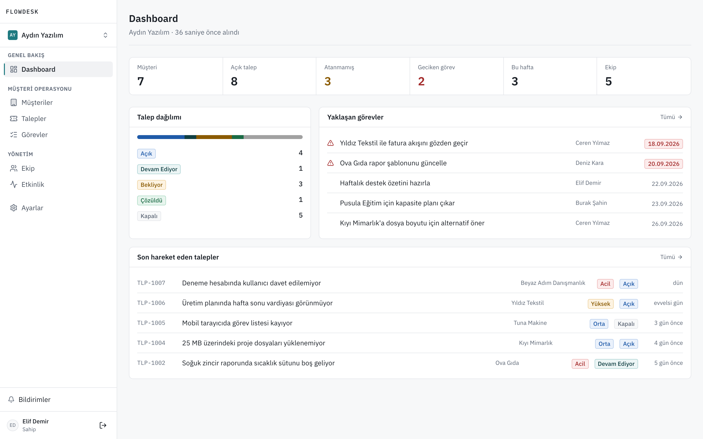
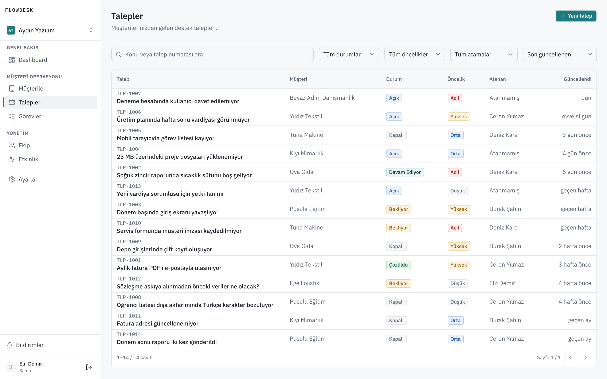
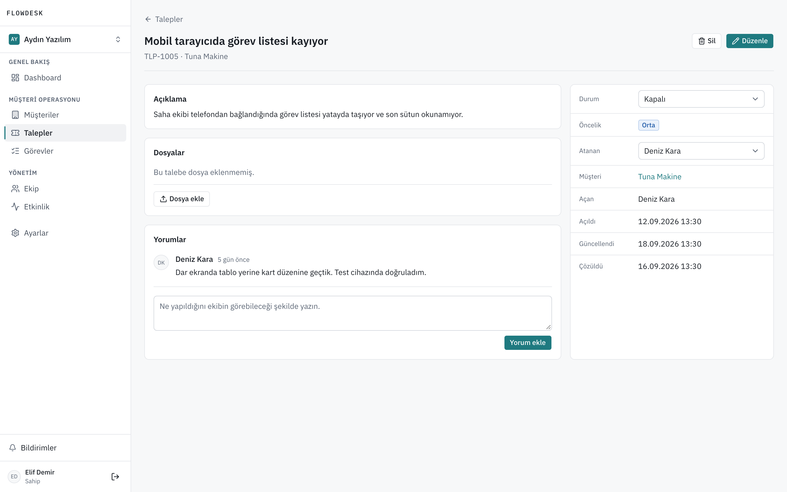
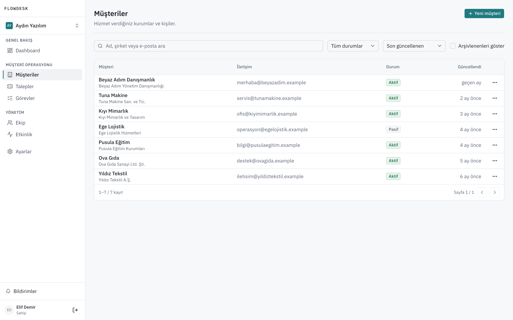
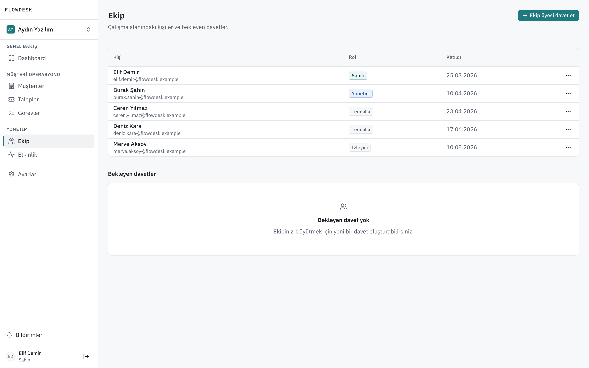
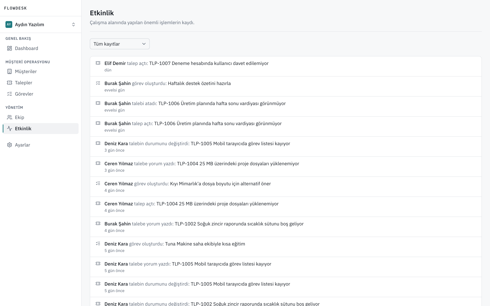
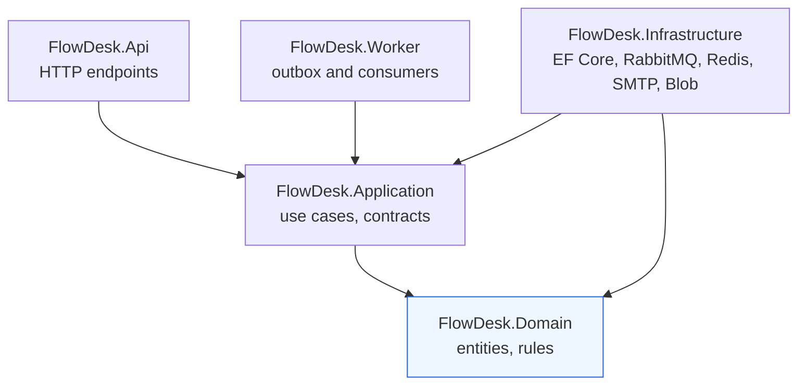

# FlowDesk


A multi-tenant B2B customer operations platform for small and mid-sized teams.
Each organization gets its own workspace holding its customers, support
tickets, tasks, invitations and role-based team.

The product interface and the in-depth documentation under `docs/` are in
Turkish; source identifiers, database columns, API routes and JSON fields are
in English, so the code reads normally to any reviewer.

> **Status:** Core scope complete. Phase-by-phase progress is tracked in
> `docs/PROGRESS.md`.

## What the project is built to demonstrate

- **Tenant isolation as a security boundary, not a convenience.** A resource
  belonging to another workspace answers `404`, never `403`. Every workspace-
  scoped endpoint is listed in one catalog and checked against the running
  application, then exercised for every role and every foreign caller.
- **Reliable messaging.** Integration events are written in the same
  transaction as the business change (outbox pattern) and published by a
  separate worker; consumers assume at-least-once delivery and are idempotent.
- **Sessions that survive scrutiny.** Rotating refresh tokens stored hashed,
  with replay detection; the access token lives only in browser memory, never
  in `localStorage`.
- **Tests against the real thing.** 546 automated tests: unit tests, plus
  integration tests that run against real PostgreSQL, RabbitMQ, Redis, blob and
  SMTP containers through Testcontainers, plus Playwright journeys driving the
  production build of the frontend. There is no mocking library. A handful of
  hand-written doubles exist where a test has to move time, force a failure or
  watch one component on its own (a clock that can be advanced, a broker that
  refuses to publish, a mail sender that records instead of sending), and the
  full request → outbox → broker → consumer → SMTP chain is verified in one
  test against the real services.
- **Deliberate restraint.** No microservices, no Kubernetes, no MediatR, no
  generic repository or unit-of-work wrapper over `DbContext`. Every
  abstraction has a stated reason; the architectural decisions are recorded as
  ADRs in `docs/DECISIONS.md`.

Build, tests, formatting, linting, types, browser tests, dependency audit and
the three production images all run on every push to `main` and on every pull
request (`.github/workflows/ci.yml`).

Where to look first: `backend/src/FlowDesk.Domain` for the rules,
`backend/tests/FlowDesk.IntegrationTests/Hardening` for the isolation and
role-matrix suite, and `docs/ARCHITECTURE.md` for the layer and deployment
diagrams.

---

## Screenshots

All screenshots are taken from the running application with demo data
(`npm --prefix e2e run screenshots`). The interface is in Turkish. Every email
address shown uses the `.example` domain; under RFC 2606 none of them can be
registered.



<table>
  <tr>
    <td width="50%"></td>
    <td width="50%"></td>
  </tr>
  <tr>
    <td>Tickets: filtering by status, priority and assignee</td>
    <td>Ticket detail: status transitions, assignment, comments and attachments</td>
  </tr>
  <tr>
    <td></td>
    <td></td>
  </tr>
  <tr>
    <td>Customers: Turkish-aware search, status filter, archiving</td>
    <td>Team: role matrix and pending invitations</td>
  </tr>
  <tr>
    <td colspan="2"></td>
  </tr>
  <tr>
    <td colspan="2">Activity: a record of what happened in the workspace and who did it</td>
  </tr>
</table>

---

## Tech stack

**Backend:** .NET 10, ASP.NET Core, Entity Framework Core, PostgreSQL

**Frontend:** Next.js, TypeScript, Tailwind CSS, TanStack Query,
TanStack Table, React Hook Form, Zod

**Infrastructure:** Docker Compose, RabbitMQ, Redis, Mailpit, Azurite

**Testing:** xUnit, WebApplicationFactory, Testcontainers, Playwright

**Observability:** Serilog, OpenTelemetry, Prometheus, Grafana

Every component was chosen because it solves a concrete problem. The
reasoning is in `docs/DECISIONS.md`.

---

## Key engineering decisions

- **Modular monolith.** Not microservices. A single team, strong consistency
  requirements and in-process calls make it the right choice at this scale.
  Module boundaries are enforced by architecture tests. (ADR-0001)
- **Tenant isolation as a security boundary.** Three layers of defense:
  membership verification, EF Core global query filters and write-side
  ownership checks. A foreign resource returns `404` rather than `403`, so the
  existence of a record never leaks. (ADR-0002, ADR-0007)
- **Token storage.** The access token is kept only in browser memory and sent
  as `Authorization: Bearer`; `localStorage` is not used. The refresh token
  lives in an `HttpOnly` cookie, rotates, is stored hashed in the database,
  and when replay is detected the whole session family is revoked. (ADR-0006)
- **Abstraction discipline.** No MediatR, no generic `IRepository<T>`, no
  generic UnitOfWork. `DbContext` already is a Unit of Work; EF Core is used
  directly and deliberately. (ADR-0004)
- **Outbox pattern.** Integration events are saved in the same transaction as
  the business data; the Worker publishes them using `FOR UPDATE SKIP LOCKED`.
  Consumers are idempotent against at-least-once delivery. (ADR-0014)
- **Incremental infrastructure.** A service is not added to Compose until the
  phase that actually uses it arrives. (ADR-0008)

---

## Architecture



Arrows show the direction of dependency. No arrow leaves Domain: it knows
nothing about infrastructure. This rule is verified by architecture tests, and
a phase does not count as complete if they fail. Layer details, the
asynchronous flow and the deployment diagrams are in
[docs/ARCHITECTURE.md](docs/ARCHITECTURE.md).

---

## Repository layout

```
backend/
  src/
    FlowDesk.Domain/          # entities, value objects, domain rules
    FlowDesk.Application/     # use cases, contracts, permissions
    FlowDesk.Infrastructure/  # EF Core, PostgreSQL, Redis, RabbitMQ, Blob, SMTP
    FlowDesk.Api/             # HTTP endpoints, auth, ProblemDetails
    FlowDesk.Worker/          # outbox publisher, message consumers
  tests/
    FlowDesk.UnitTests/
    FlowDesk.IntegrationTests/
frontend/                     # Next.js App Router application
e2e/                          # Playwright scenarios
infra/                        # Docker Compose and service configuration
docs/                         # project documentation (Turkish)
```

Dependencies point one way: `Api`/`Worker` → `Application` → `Domain`, and
`Infrastructure` → `Application`/`Domain`. Domain depends on no
infrastructure.

---

## Requirements

| Tool | Version |
|---|---|
| .NET SDK | 10.0.x |
| Node.js | 22.x (LTS) |
| Docker + Compose | Current release |

If the .NET 10 SDK is not installed, the official script can install it side
by side:

```bash
curl -fsSL https://dot.net/v1/dotnet-install.sh -o dotnet-install.sh
chmod +x dotnet-install.sh
./dotnet-install.sh --channel 10.0 --install-dir "$HOME/.dotnet"
```

<details>
<summary>macOS 26 / Apple Silicon: if you get <code>SIGKILL</code> after installing</summary>

When the script overwrites an existing `~/.dotnet` installation, the host
binary can be killed with `SIGKILL (Code Signature Invalid)`. The signature is
actually valid; the problem is a stale assessment the kernel keeps for that
inode. Replacing the host binary with a new inode fixes it:

```bash
cd ~/.dotnet && cp dotnet dotnet.new && mv -f dotnet.new dotnet && chmod +x dotnet
dotnet --version
```

</details>

---

## Getting started

```bash
# 1. Prepare environment variables
cp .env.example .env
# Replace the sample passwords in .env with your own local values

# 2. Start the infrastructure
#    For observability, add: --profile observability
docker compose --env-file .env -f infra/docker-compose.yml up -d

# 3. Load .env into the shell
#    Compose reads the file through --env-file, but the .NET processes do not:
#    they take their configuration from environment variables. Without this
#    line the API stops with "PostgreSQL connection string is not configured".
#    Repeat in every new terminal (bash/zsh).
set -a && . ./.env && set +a

# 4. Install the .NET tools pinned in the repository (dotnet-ef)
dotnet tool restore

# 5. Create the database
dotnet ef database update \
  -p backend/src/FlowDesk.Infrastructure \
  -s backend/src/FlowDesk.Api

# 6. API
dotnet run --project backend/src/FlowDesk.Api

# 7. Worker: it produces emails and notifications; the API alone does not
#    drain the outbox, so no invitation email is sent without it
dotnet run --project backend/src/FlowDesk.Worker

# 8. Frontend
npm --prefix frontend install
npm --prefix frontend run dev
```

The API, the Worker and the frontend are separate processes; all three run at
the same time, each in its own terminal. Run the `set -a` line from step 3
first in every terminal.

### Ports

The project deliberately shifts the default ports, since `5432`, `6379` and
`5000` are commonly taken on development machines. All of them can be changed
through `.env`.

| Service | Port | Introduced in phase |
|---|---|---|
| Frontend | 3000 | 01 |
| API | 5080 | 01 |
| PostgreSQL | 5433 | 01 |
| RabbitMQ / management UI | 5672 / 15672 | 10 |
| Mailpit SMTP / UI | 1025 / 8025 | 12 |
| Azurite (blob service only) | 10000 | 13 |
| Redis | 6380 | 15 |
| Prometheus (`observability` profile) | 9090 | 18 |
| Grafana (`observability` profile) | 3001 | 18 |
| E2E frontend / API (started by the suite) | 3100 / 5180 | 17 |
| Caddy (production-like stack) | 8080 | 20 |

### Demo data

An empty database does not explain the product. The seed writes two
workspaces that look like they have been in use for a while: customers,
tickets with history, comments, tasks, an activity feed and unread
notifications.

```bash
dotnet run --project backend/src/FlowDesk.Api -- --seed-demo-data
```

The process writes and exits; it listens on no port. Run a second time, it
reports the current state and writes nothing.

| Account | Aydın Yazılım | Marmara Lojistik |
|---|---|---|
| `elif.demir@flowdesk.example` | Owner | Admin |
| `burak.sahin@flowdesk.example` | Admin | — |
| `ceren.yilmaz@flowdesk.example` | Agent | — |
| `deniz.kara@flowdesk.example` | Agent | Owner |
| `merve.aksoy@flowdesk.example` | Viewer | — |

Elif has different roles in the two workspaces, so tenant isolation and the
role matrix are visible on screen. The addresses use the `.example` domain
(RFC 2606); none can be registered and none belongs to a real person.

The development password is `DemoParola2026`. Outside development,
`DemoData__Password` must be provided, otherwise the seed does not run.
Reasoning: ADR-0045.

The screenshots above are generated from this data. With the application
running:

```bash
npm --prefix e2e run screenshots
```

---

## Verification

```bash
# Backend
dotnet build backend/FlowDesk.slnx
dotnet test  backend/FlowDesk.slnx

# Frontend
npm --prefix frontend run format:check
npm --prefix frontend run lint
npm --prefix frontend run typecheck
npm --prefix frontend run build

# E2E: the Compose services must be up; the suite starts the API, the Worker
# and the frontend itself, on its own ports
npm --prefix e2e ci
npx --prefix e2e playwright install chromium
npm --prefix e2e run format:check
npm --prefix e2e run typecheck
npm --prefix e2e test

# Dependency scan
./scripts/security-scan.sh
```

All of these also run in CI on every push to `main` and on every pull request
(`.github/workflows/ci.yml`).

### Production-like run

```bash
docker compose --env-file .env \
  -f infra/docker-compose.yml -f infra/docker-compose.prod.yml up -d --build
# http://localhost:8080 serves the frontend and the API under one origin (Caddy)
```

Integration tests use a real PostgreSQL instance through Testcontainers; it is
never swapped for SQLite. Docker must be running.

---

## Security

This repository is public and contains no real secrets. `.env.example` holds
sample values only; real values are supplied through environment variables,
.NET user-secrets or GitHub Secrets.

The authentication model, the authorization permission matrix, the tenant
isolation defense layers and the mandatory security tests are described in
`docs/SECURITY.md`.

---

## Documentation

The documents below are written in Turkish.

| Document | Contents |
|---|---|
| [docs/PRODUCT.md](docs/PRODUCT.md) | Product definition, roles, user flows |
| [docs/ARCHITECTURE.md](docs/ARCHITECTURE.md) | Layers, dependency direction, infrastructure, ports |
| [docs/SECURITY.md](docs/SECURITY.md) | Authentication, authorization, tenant isolation |
| [docs/DATABASE.md](docs/DATABASE.md) | Data model, indexes, constraints, migrations |
| [docs/API_CONVENTIONS.md](docs/API_CONVENTIONS.md) | REST conventions, error format, pagination |
| [docs/DESIGN_SYSTEM.md](docs/DESIGN_SYSTEM.md) | Design direction, tokens, component rules |
| [docs/DECISIONS.md](docs/DECISIONS.md) | Architecture decision records (ADRs) |
| [docs/ROADMAP.md](docs/ROADMAP.md) | Phase plan and out-of-scope features |
| [docs/PROGRESS.md](docs/PROGRESS.md) | Phase progress and verification status |
| [docs/HANDOFF.md](docs/HANDOFF.md) | Development handoff notes |
